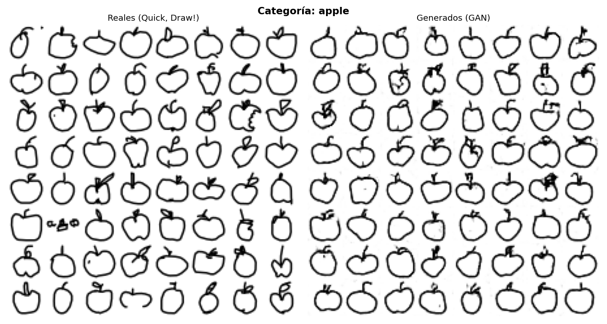
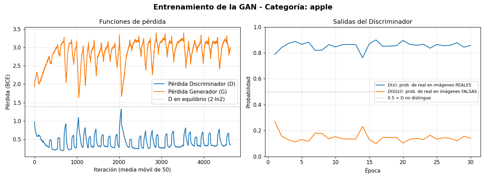

# GAN con Quick, Draw! — Categoría: **apple**

Taller para entender cómo funciona una **GAN** (Red Generativa Antagónica) con **dos redes neuronales**:

| Red | Rol | Dónde se crea |
|---|---|---|
| **Generadora (G)** | Convierte ruido aleatorio en un dibujo de manzana de 28×28 | [`src/models/generator.py`](src/models/generator.py) → `build_generator` |
| **Discriminadora (D)** | Decide si un dibujo es real o falso | [`src/models/discriminator.py`](src/models/discriminator.py) → `build_discriminator` |

Ambas se **instancian** en [`src/train.py`](src/train.py) (sección «2) REDES NEURONALES») y en el notebook.
En el código busca los carteles `>>> AQUÍ SE CREA LA RED NEURONAL ... <<<`.

- **Categoría usada:** `apple` (manzana), del dataset [Quick, Draw!](https://github.com/googlecreativelab/quickdraw-dataset).
- **Datos:** 144 722 dibujos disponibles; se usan **20 000** para entrenar (imágenes *numpy bitmap* de 28×28).

> 🌐 **Este proyecto incluye una página web interactiva con todos los resultados del taller:**
> [`docs/informe_apple.html`](docs/informe_apple.html). Es un único archivo: ábrelo con doble clic en tu navegador
> (no necesita Python ni Jupyter). Tiene un deslizante para ver cómo aprende la GAN época a época, los
> parámetros de ambas redes, las funciones de pérdida y las curvas de entrenamiento.
> Más detalles en [Informe web interactivo](#informe-web-interactivo).

## Resultado



Los dibujos de la derecha **no existen en el dataset**: los inventó el Generador a partir de ruido.

## Inicio rápido

```bash
pip install -r requirements.txt

python -m src.train                  # descarga 'apple', entrena 30 épocas (~1 min con GPU)
python -m src.utils.inspect_models   # muestra capas, parámetros y valores de las redes
python -m src.report.build_report    # genera el informe web interactivo (docs/informe_apple.html)
python -m pytest                     # pruebas automáticas
```

Opciones de `src.train`: `--category star`, `--epochs 5`, `--num-samples 10000`, `--batch-size 64`.
Si prefieres el taller guiado, abre [`notebooks/taller.ipynb`](notebooks/taller.ipynb)
(requiere `pip install ipykernel jupyter`).

Todo se guarda en `outputs/apple/`: `real_vs_generated.png`, `training_curves.png`, `evolution.gif`,
`samples/` (una imagen por época), `history.json` y `checkpoint.pt`.

## Informe web interactivo

`docs/informe_apple.html` es **un único archivo** que se abre con doble clic en cualquier navegador (sin Python ni Jupyter). Incluye:
deslizante de evolución época a época, dibujos reales frente a generados, diagrama de las dos redes con sus parámetros,
pesos antes y después de entrenar, funciones de pérdida, curvas con tooltip, valores de salida, tema claro/oscuro y tabla de datos.
Se regenera con `python -m src.report.build_report` después de entrenar.

## Estructura

```
src/
├── config.py               # TODOS los hiperparámetros y la categoría
├── train.py                # punto de entrada
├── data/downloader.py      # descarga y valida UNA categoría
├── data/dataset.py         # Dataset de PyTorch, normaliza a [-1, 1]
├── models/generator.py     # Red GENERADORA
├── models/discriminator.py # Red DISCRIMINADORA
├── training/losses.py      # funciones de pérdida (con la matemática explicada)
├── training/trainer.py     # bucle de entrenamiento adversario
├── training/history.py     # registro de métricas
├── report/build_report.py  # genera el informe web (datos reales -> HTML)
├── report/template.html    # plantilla del informe (HTML + CSS + JS)
└── utils/                  # inspección de redes, gráficas, logging, semillas
tests/                      # pruebas con pytest
notebooks/taller.ipynb      # taller paso a paso
```

## Parámetros de la red GENERADORA

Entrada: ruido `z` de forma `(B, 100)` → salida: imagen `(B, 1, 28, 28)` con valores en [-1, 1].

| Capa | Salida | Parámetros | Qué hace |
|---|---|---|---|
| `ConvTranspose2d(100→256, k=7)` | `256×7×7` | 1 254 400 | Convierte el ruido (1×1) en 256 mapas de 7×7 |
| `BatchNorm2d` + `ReLU` | `256×7×7` | 512 | Normaliza y añade no linealidad |
| `ConvTranspose2d(256→128, k=4, s=2)` | `128×14×14` | 524 288 | Duplica la resolución |
| `BatchNorm2d` + `ReLU` | `128×14×14` | 256 | Igual que arriba |
| `ConvTranspose2d(128→1, k=4, s=2)` | `1×28×28` | 2 049 | Duplica otra vez y deja 1 canal (gris) |
| `Tanh` | `1×28×28` | 0 | Fuerza la salida al rango [-1, 1] |

**Total: 1 781 505 parámetros.** Fórmula de una `ConvTranspose2d`: `entrada × salida × k × k (+ sesgo)`.

## Parámetros de la red DISCRIMINADORA

Entrada: imagen `(B, 1, 28, 28)` → salida: un *logit* por imagen `(B,)`. `sigmoid(logit)` = probabilidad de que sea real.

| Capa | Salida | Parámetros | Qué hace |
|---|---|---|---|
| `Conv2d(1→64, k=4, s=2)` + `LeakyReLU(0.2)` | `64×14×14` | 1 024 | Reduce a la mitad y detecta trazos |
| `Conv2d(64→128, k=4, s=2)` | `128×7×7` | 131 072 | Detecta formas más complejas |
| `BatchNorm2d` + `LeakyReLU` + `Dropout(0.3)` | `128×7×7` | 256 | Estabiliza; Dropout evita que D «gane» demasiado |
| `Conv2d(128→1, k=7)` | `1×1×1` | 6 273 | Resume todo en un único número (logit) |

**Total: 138 625 parámetros.** D es ~13 veces más pequeña que G: es suficiente para clasificar y deja a G margen para aprender.

## Funciones de pérdida

Ver [`src/training/losses.py`](src/training/losses.py). Etiquetas: real = 1, falso = 0.

| Red | Objetivo | Pérdida |
|---|---|---|
| **D** | `D(x)→1` y `D(G(z))→0` | `L_D = −log D(x) − log(1 − D(G(z)))` |
| **G** | `D(G(z))→1` (engañar a D) | `L_G = −log D(G(z))` |

Valores de referencia en equilibrio (D no distingue, `D = 0.5`): `L_D = 2·ln2 ≈ 1.386` y `L_G = ln2 ≈ 0.693`.

## Hiperparámetros de entrenamiento

Definidos en [`src/config.py`](src/config.py).

| Parámetro | Valor | Para qué sirve |
|---|---|---|
| `latent_dim` | 100 | Tamaño del vector de ruido de G |
| `batch_size` | 128 | Imágenes por lote |
| `epochs` | 30 | Pasadas completas por los datos |
| `lr` | 0.0002 | Tasa de aprendizaje (Adam) |
| `beta1` | 0.5 | Momento de Adam; 0.5 estabiliza GANs |
| `d_dropout` | 0.3 | Fracción de neuronas apagadas en D |
| `seed` | 42 | Reproducibilidad |

Los pesos se inicializan con `Normal(0, 0.02)` (paper DCGAN).

## Cómo leer los valores durante el entrenamiento

Cada época se imprime: `Loss D | Loss G | D(x) | D(G(z))`.

- `D(x)`: probabilidad que D asigna a una imagen **real**. `D(G(z))`: la que asigna a una **falsa**.
- En esta ejecución, `D(x) ≈ 0.86` y `D(G(z)) ≈ 0.14`: D va algo por delante, pero G logra manzanas reconocibles.
- Si `D(G(z))` cayera a 0 y `Loss G` se disparara, D habría «ganado» y G dejaría de aprender.
- Las pérdidas **oscilan** en lugar de bajar de forma constante: G y D se persiguen mutuamente. Es normal.
- Las pérdidas no miden la calidad por sí solas: **hay que mirar las imágenes** (`outputs/apple/samples/`).



## Buenas prácticas aplicadas

- Configuración centralizada (`Config` inmutable), sin «números mágicos».
- Un módulo por responsabilidad; `logging` en lugar de `print`; *type hints* y docstrings.
- Reproducibilidad con semilla; descarga atómica (`.part` → `.npy`) y validación del archivo.
- Pruebas con `pytest` (formas, rangos, pérdidas con valores teóricos, entrenamiento mínimo) y `ruff` sin avisos.

## Notas y limitaciones

- Es una GAN pequeña (DCGAN a 28×28): algunas manzanas salen con el tallo borroso. Más épocas o una arquitectura mayor mejorarían la calidad.
- Cambiar de categoría es solo `python -m src.train --category star`; la arquitectura no cambia.
